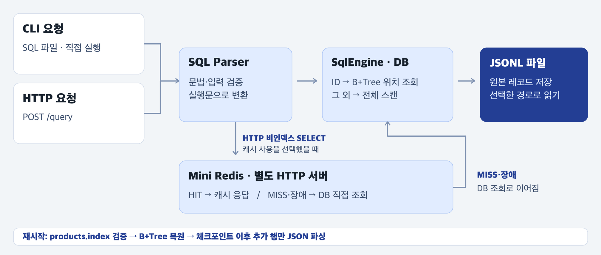
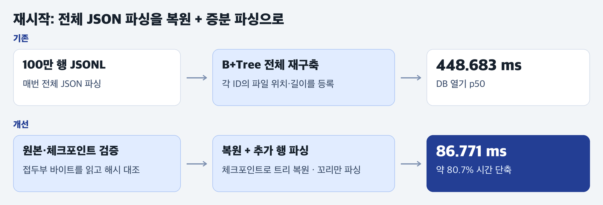
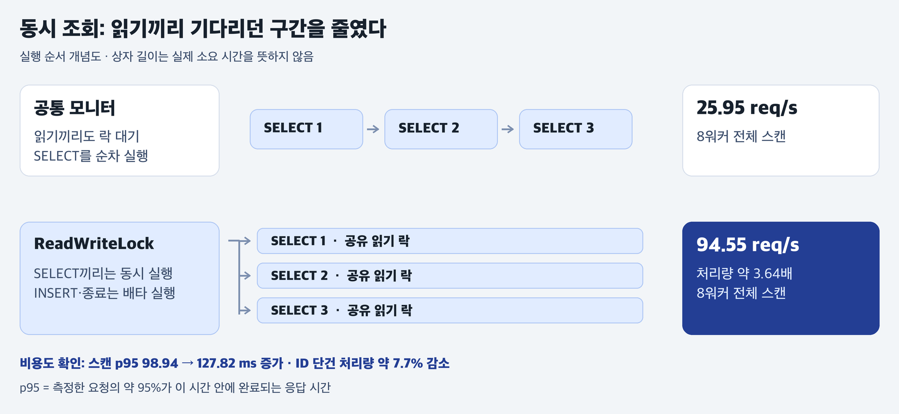
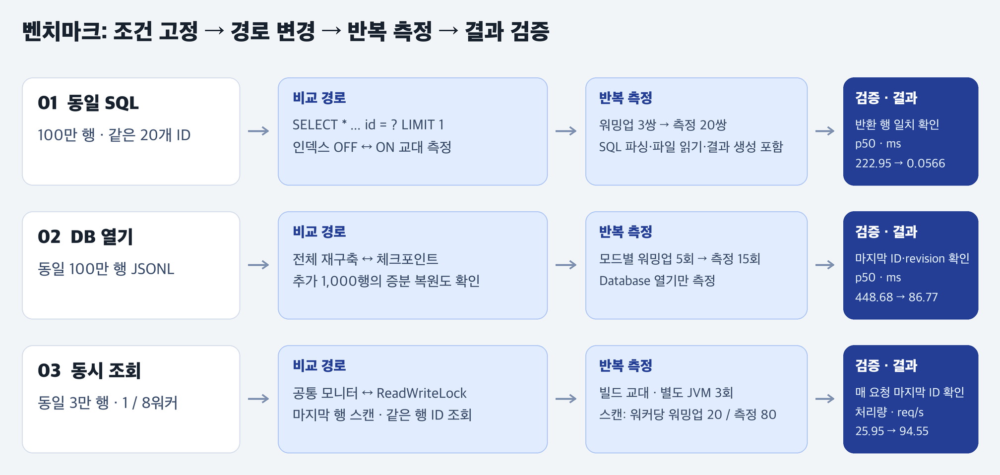
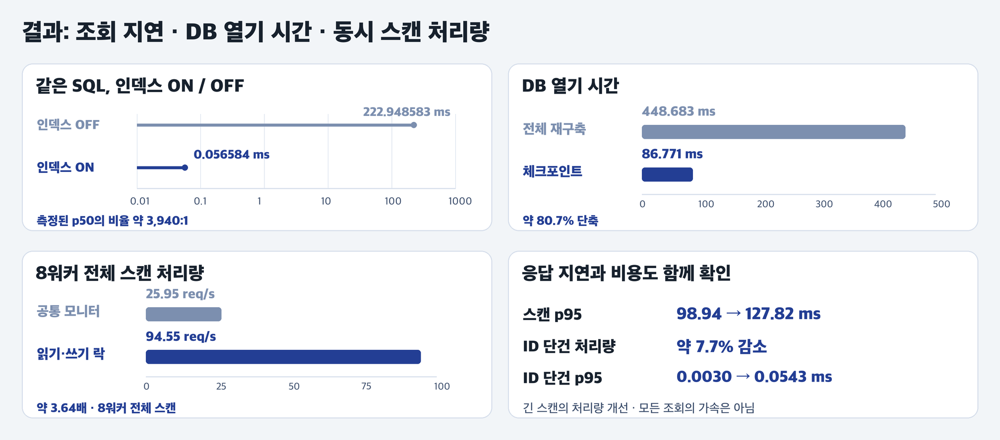

# Mini DBMS

### 서로 다른 구현의 장점을 선별하고, 실제 병목을 해결하다

**직접 구현한 DBMS + Redis · AI를 활용한 설계 비교와 선별 통합 · 벤치마크로 확인한 개선**
Java 25 · B+Tree · HTTP API · JUnit 5

## 01. 아키텍쳐

**원본 데이터는 JSONL에, ID의 파일 위치는 B+Tree에, 반복되는 비인덱스 조회 결과는 Redis에 저장한다.**

| 구성 | 담당하는 일 | 핵심 구분 |
|---|---|---|
| **B+Tree** | ID → 파일의 바이트 위치·길이, ID 범위는 연결된 리프 순회 | 필요한 레코드를 파일에서 읽는다. |
| **products.jsonl** | 실제 레코드를 저장하는 원본 파일 | 비인덱스 조회는 파일을 순회한다. |
| **Mini Redis** | HTTP 비인덱스 SELECT 결과를 선택적으로 캐싱 | **HIT**은 캐시 응답, **MISS·장애**는 DBMS 조회. ID 조회는 우회한다. |
| **products.index** | 재시작용 체크포인트 | 원본을 대체하지 않는다. 검증 실패 시 JSONL 전체 검증·재구축으로 돌아간다. |

## 02. 차별점 — 두 가지 병목을 어떻게 개선했나?

### ① 재시작: 매번 JSON을 해석하던 비용을 줄였다

| 비교 기준 | 기존: 전체 재구축 | 개선: 체크포인트 복원 |
|---|---|---|
| 재시작 흐름 | 100만 행 JSON 파싱 → 인덱스 재구축 | 접두부 바이트·해시 검증 → 인덱스 복원 → 추가 행만 JSON 파싱 |
| DB 열기 p50 | 448.683 ms | **86.771 ms · 약 80.7% 단축** |
| 999,000행 복원 + 1,000행 추가 | 전체 재구축 | **87.346 ms** |
| 남는 비용 | 원본 읽기·파싱·인덱스 생성 | **접두부 읽기·해시 검증·메모리 트리 생성은 유지** |

**줄인 것은 매번 전체 JSON을 해석하는 비용이다. 파일 읽기를 전부 없앤 것은 아니다.**
100만 행·동일 JSONL·워밍업 5회·측정 15회. 측정 범위는 `Database` 열기이며 JVM 시작과 HTTP 기동은 제외했다.

### ② 동시 조회: 읽기끼리 기다리던 구조를 바꿨다

| 비교 기준 | 기존: 공통 모니터 | 개선: 공정 ReadWriteLock |
|---|---|---|
| SELECT 실행 | 읽기끼리도 순차 실행 | **읽기 락 공유 → SELECT 동시 실행** |
| INSERT·종료 | 모든 명령과 상호 배제 | 쓰기 락으로 읽기·쓰기와 상호 배제 |
| 8워커 전체 스캔 처리량 | 25.95 req/s | **94.55 req/s · 약 3.64배** |
| 8워커 전체 스캔 p95 | 98.94 ms | **127.82 ms로 증가** |
| 8워커 ID 단건 처리량 | 690,235.82 req/s | **636,901.64 req/s · 약 7.7% 감소** |

**긴 스캔의 총처리량은 늘었지만, 모든 조회의 응답 시간이 줄어든 것은 아니다.**
30,000행·1/8워커·별도 JVM 3회 중앙값. HTTP·Redis·SQL 파싱은 제외한 DB 실행 측정이며, **PR #64는 아직 미병합**이다.

## 03. AI 활용 — 두 구현에서 무엇을 선별했나?

### AI 비교 기준표

| 비교 기준 | 영민 — **저장·복구와 독립 구조** | 예준 — **조회 확장과 관찰·비교** | 선별 통합한 결과 |
|---|---|---|---|
| **B+Tree** | ID에 대응하는 **파일 위치 + 길이** 저장 | 리프의 **next 연결을 따라 범위 순회** | 영민의 포인터 구조를 유지하고 **ID BETWEEN** 접목 |
| **TTL·복구** | 조회 시 만료 확인, **AOF 기록·재시작 복구** | 주기적인 **능동 만료**, 버킷 대시보드 | AOF를 유지하고 **1초 주기 정리** 추가 |
| **서버·캐시** | Redis·DBMS를 **별도 HTTP 서버**로 실행 | 데이터 **버전 기반 조회 캐싱** 아이디어 | 독립 서버를 유지하고 **버전·재시작 식별자·장애 우회** 결합 |
| **성능 검증** | **ID 조건 vs name 조건**으로 동일 행 조회 | **동일 ID SQL**의 인덱스 ON/OFF 비교 | 쿼리와 결과를 고정해 **접근 경로 차이**를 비교 |

**영민의 저장·복구 구조를 바탕으로, 예준의 범위 조회·능동 TTL·동일 SQL 비교 방식을 선택해 결합했다.** **AI로 두 구현의 차이와 기존 계약의 충돌 지점을 비교하고, 선별한 기능을 테스트와 실제 프로세스 실행으로 확인했다.**

## 04. 최종 결과 — 무엇을, 어떻게 비교했나?

### 측정 결과

**지표 읽기:** p50 = 중앙값 · p95 = 요청의 약 95%가 완료되는 시간 · req/s = 초당 처리 요청 수

| 실험·조건 | 비교 경로 | p50 (ms) | p95 (ms) | 처리량 (req/s) |
|---|---|---:|---:|---:|
| **동일 SQL · 100만 행** | 인덱스 OFF · ID 선형 탐색 | 222.948583 | 356.494584 | — |
| ↳ 같은 20개 ID·같은 결과 | **인덱스 ON · B+Tree** | **0.056584** | **0.111125** | — |
| **DB 열기 · 100만 행** | 전체 JSONL 재구축 | 448.683 | 1368.080 | — |
| ↳ 동일 파일·워밍업 5/측정 15회 | **체크포인트 복원** | **86.771** | **158.245** | — |
| **동시 스캔 · 3만 행·8워커** | 공통 모니터 | — | 98.9353 | 25.95 |
| ↳ 별도 JVM 3회 중앙값 | **ReadWriteLock · 미병합 PR** | — | **127.8202** | **94.55** |

**동일 SQL에서 접근 경로의 효과를 확인하고, 재시작 파싱 비용과 읽기 직렬화라는 서로 다른 병목을 줄였다.**

| 결과를 읽을 때 | 확인한 범위 |
|---|---|
| **인덱스 효과** | 동일 SQL의 p50 비율은 약 **3,940:1**. 전체 시스템이나 모든 쿼리의 속도 향상을 뜻하지 않는다. |
| **재시작 개선** | 워밍업한 JVM·OS 파일 캐시에서 **DB 열기 시간 약 80.7% 단축**. JVM 시작·HTTP 기동·종료 시간은 제외했다. |
| **동시성 개선과 비용** | 전체 스캔 처리량 **약 3.64배**. 스캔 p95는 증가했고 ID 단건 처리량은 **약 7.7% 감소**, p95는 **0.0030 → 0.0543 ms**로 증가했다. |
| **실측 환경** | 동일 SQL: macOS 14.8.9/aarch64/Java 25.0.5.1/heap 512 MiB. 재시작·동시성: Apple M1 Pro 8코어/16 GB/Java 25.0.5.1/heap 512 MiB. |
| **반영 상태** | 선별 통합은 로컬 코드에 있음. 체크포인트는 원격 `ym-mini-dbms`에 반영됨. ReadWriteLock은 **초안 PR #64**. |

벤치마크 조건과 근거 자료

- **동일 SQL:** `SELECT * FROM products WHERE id = ? LIMIT 1`. 100만 행, 고정 seed로 선택한 동일 20개 키, 워밍업 3쌍 후 인덱스 ON/OFF를 교대 측정하고 반환 행을 대조했다. 단일 스레드이며 SQL 파싱·실행·파일 읽기·결과 생성이 포함된다. HTTP·Redis는 제외한다. [검증 기록](docs/mini-dbms/kjf-64-verification.md) · [원시 지연 JSON](docs/mini-dbms/benchmarks/kjf-64-same-sql-million.json)
- **재시작:** 동일 JSONL 1,000,000행/50,666,792바이트. `new Database` 직전부터 열기 완료까지 측정한다. 모드별 워밍업 5회·측정 15회, 마지막 ID·revision을 확인했다. 템플릿 복사·검증 조회·종료는 제외한다. 워밍업한 JVM·OS 파일 캐시 조건이며 15표본의 최근접 순위 p95는 최댓값이다. [고정 커밋의 검증 기록](https://github.com/kylekim0868-cpu/krafton-jungle-framework2/blob/c7f438568ae300d393e936a8da42f9f5d5b1f8d5/docs/mini-dbms/dbms-04-verification.md)
- **동시성:** 동일 30,000행 JSONL·체크포인트, 마지막 행의 name 스캔과 같은 행의 ID 인덱스 조회를 비교한다. 1/8워커, 빌드 교대·별도 JVM 3회. 워커당 스캔 워밍업 20/측정 80회, 인덱스 워밍업 10,000/측정 50,000회. 처리량·p95의 실행별 중앙값이다. HTTP·Redis·SQL 파싱·파일 열기는 제외한다. 스캔 p95의 실행 간 범위는 모니터 53.97–2335.56 ms, ReadWriteLock 87.93–149.55 ms다. 쓰기 지연은 측정하지 않았다. [고정 커밋의 검증 기록](https://github.com/kylekim0868-cpu/krafton-jungle-framework2/blob/b3519238d2bc896f1bc6a4643db840ed9366d2e6/docs/mini-dbms/dbms-05-verification.md) · [초안 PR #64](https://github.com/kylekim0868-cpu/krafton-jungle-framework2/pull/64)
- **선별 통합 검증:** [DBMS](docs/mini-dbms/kjf-64-verification.md) · [Redis](docs/mini-redis/kjf-64-verification.md). 모든 수치는 기존 로컬 실험 기록에서 가져왔으며 이번 문서 수정 과정에서 벤치마크를 재실행하지 않았다.

---

[발표 대본 — 3분 50초](docs/mini-dbms/week12-presentation-script.md)
